# ELEC3 – Node.js

**Name:** Airish Dhyn D. Castillo  
**Section:** IV-BSIT A  
**Course:** ELEC3 – Node.js

## Set 1 Activities

### N1 – Project Setup and Package Management

Created a Node.js project using npm, installed packages, configured the `package.json` file, and ran the application using `npm start`.

**Folder:** [set1/n1-setup](set1/n1-setup/)

**Run the project:**
```bash
cd set1/n1-setup
npm install
npm start
```

## Screenshots

### N1 – Project Setup and Package Management

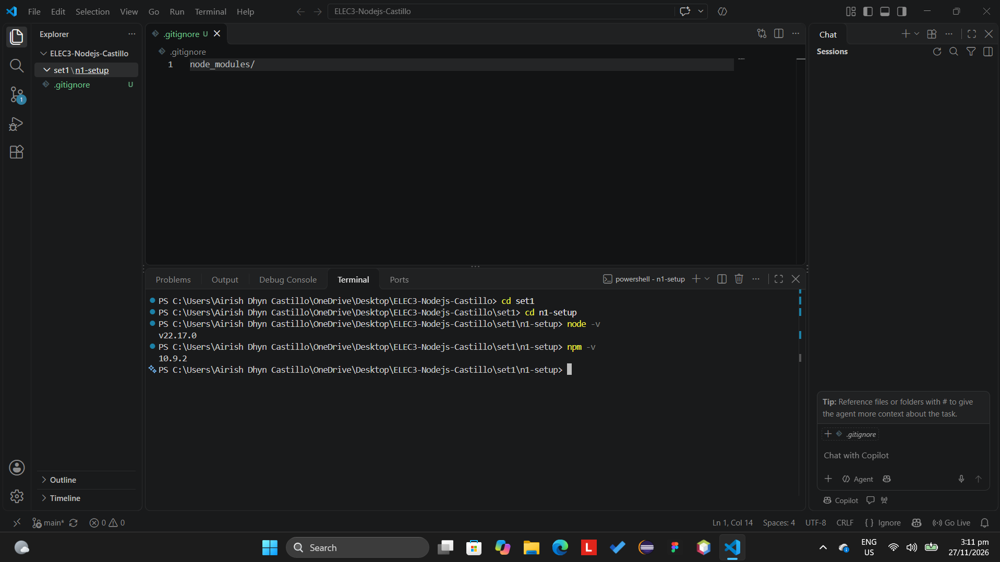

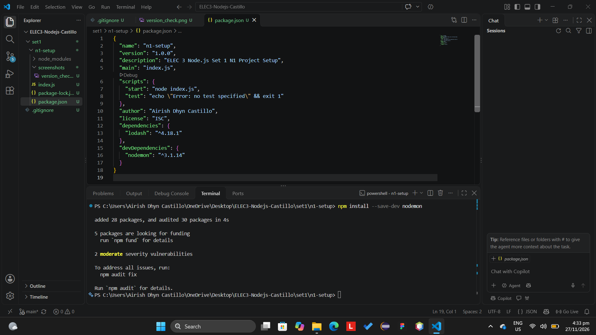

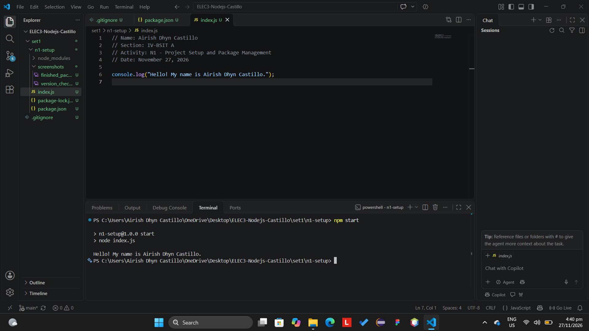


### N2 – Modular Calculator

Created a Node.js calculator using custom modules, require(), and module.exports. The program supports addition, subtraction, multiplication, division, and average operations, and handles division by zero and unknown operations with clear error messages.

**Folder:** [set1/n2-calculator](set1/n2-calculator/)

**Run the project:**
```bash
cd set1/n2-calculator
node index.js add 12 8
node index.js subtract 12 8
node index.js multiply 12 8
node index.js divide 12 8
node index.js average 12 8
```

## Screenshots

### N2 – Modular Calculator

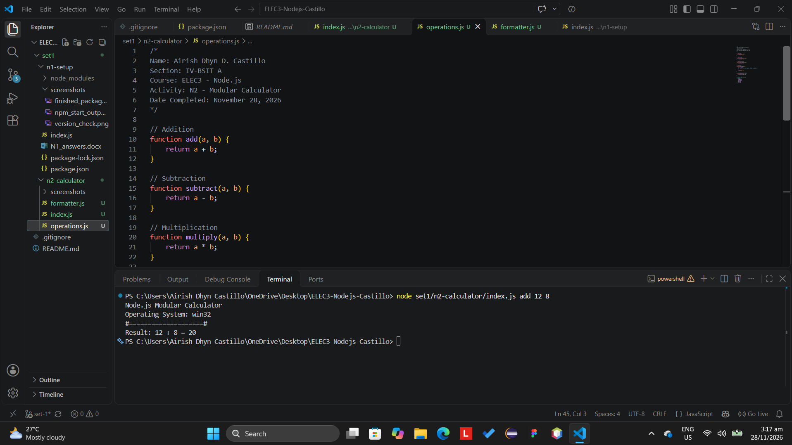

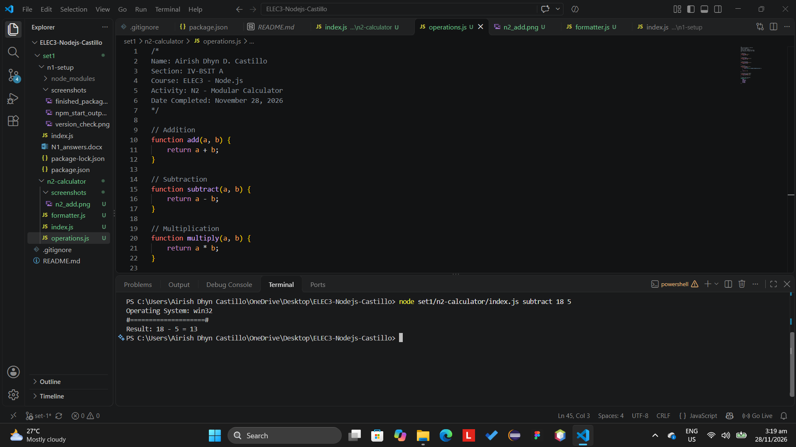

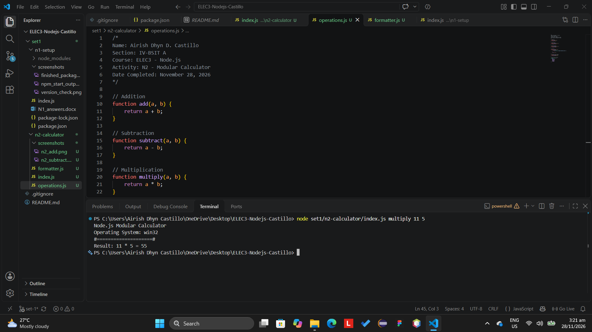

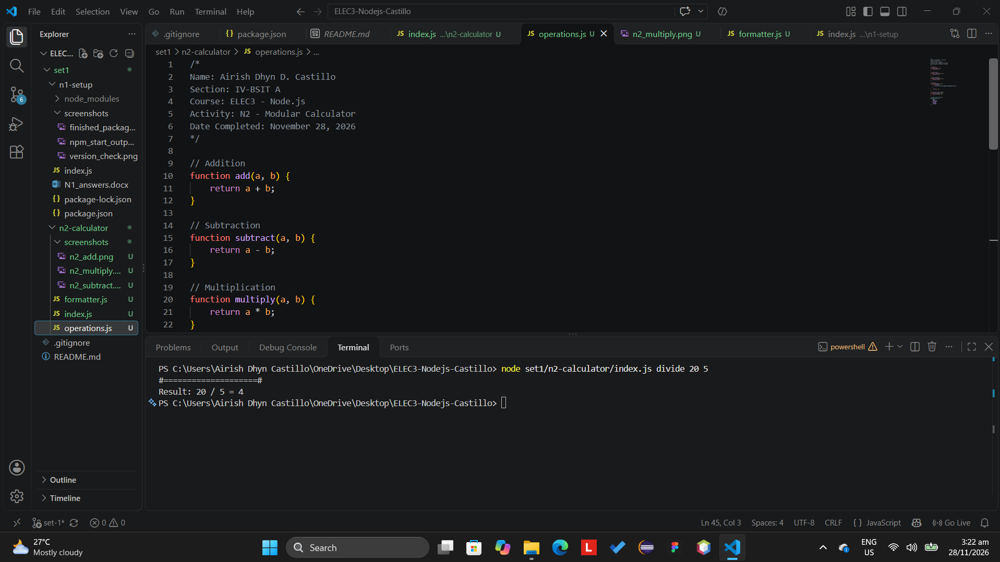

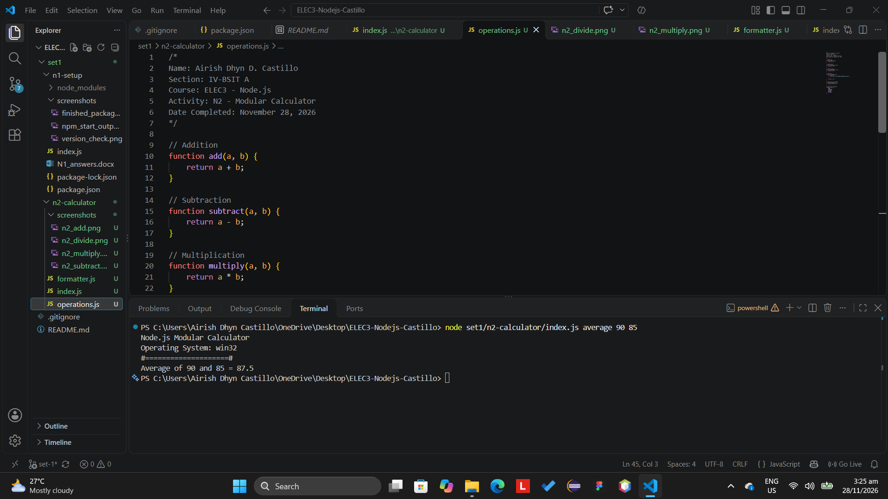

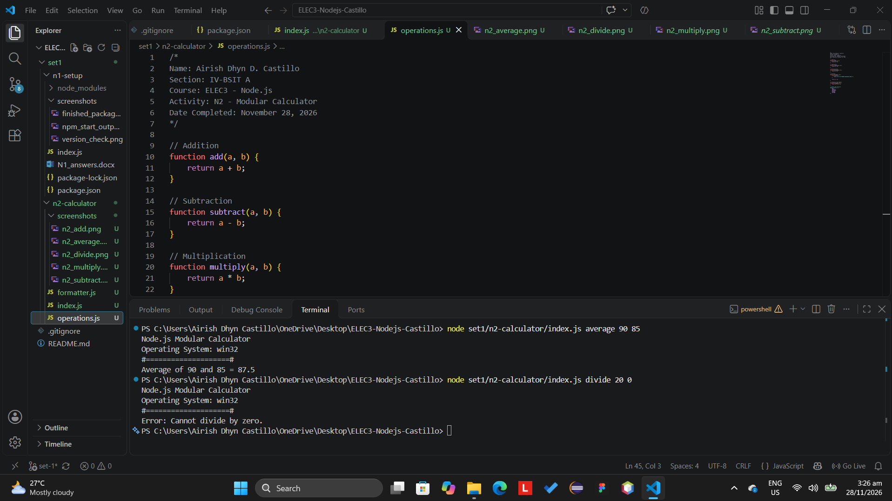

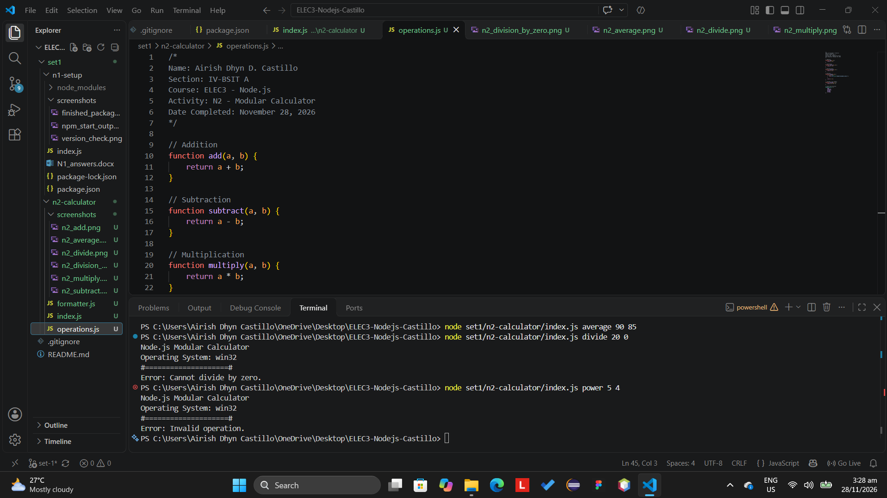


### N3 – File Manager with fs and path 

A command-line file manager using Node.js built-in fs and path modules to create, read, update, delete, and list text files.

**Folder:** [set1/n3-file-manager](set1/n3-file-manager/)

**Run the project:**
```bash
node index.js
node index.js create notes.txt "Hello"
node index.js read notes.txt
node index.js update notes.txt " New text"
node index.js delete notes.txt
node index.js list
```

## Screenshots

### N3 – File Manager with fs and path 

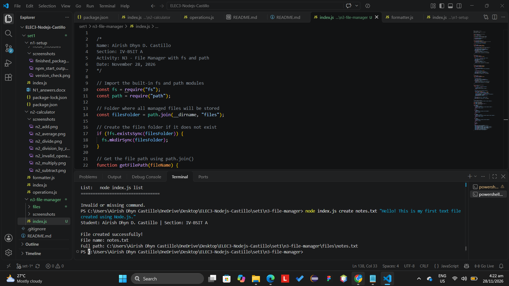

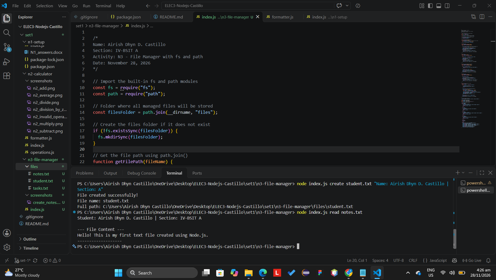

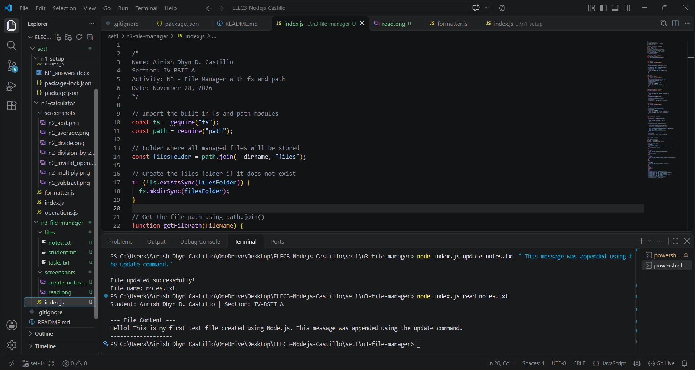

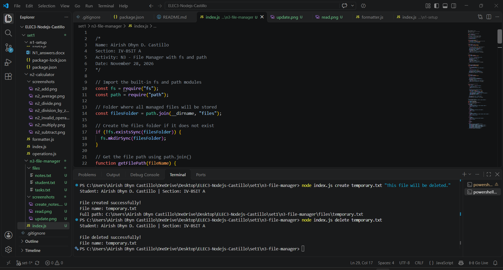

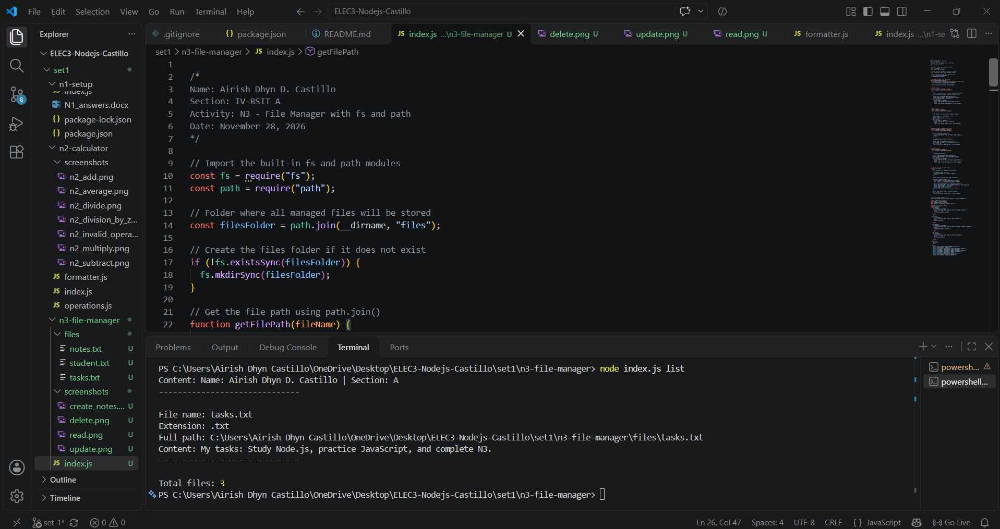
